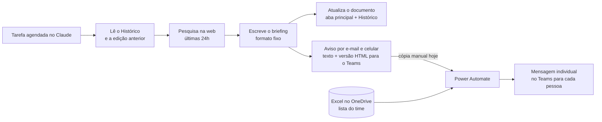

# Briefing Diário de Mercado — Claude + Power Automate

Uma tarefa agendada no Claude pesquisa todo dia as notícias do mercado em que trabalho e monta um briefing de análise. Depois, um fluxo no Power Automate manda esse briefing para cada pessoa do time no Teams.

Comecei fazendo isso só para mim, para acompanhar o setor e achar ideias que pudessem ser aplicadas no trabalho. Depois, quis que o time inteiro também recebesse.

> Não tem código tradicional aqui. O projeto é feito de uma **instrução (prompt) agendada no Claude**, de um **documento compartilhado** que guarda o histórico e de um **fluxo no Power Automate**. Este repositório documenta as três partes para quem quiser fazer algo parecido.

---

## Como funciona

## Estrutura

| Arquivo | Conteúdo |
|---|---|
| `README.md` | Visão geral, etapas, decisões e cuidados |
| `prompt/instrucao-briefing.md` | Modelo da instrução usada na tarefa agendada, com `{campos}` para adaptar |
| `power-automate/fluxo-teams.md` | Como o fluxo de envio pelo Teams está montado |

---

## 1. Tarefa agendada no Claude

| Item | Configuração |
|---|---|
| Nome | Briefing diário de mercado |
| Frequência | Todo dia, de manhã (fuso America/Sao_Paulo) |
| Execução | Na nuvem, sem depender do meu computador e sem pedir aprovação a cada execução |
| Avisos | E-mail da conta Claude e notificação no celular |
| Conectores | Nenhum de e-mail, agenda ou chat. Só pesquisa na web |
| Memória | Cada execução começa do zero. A única memória é a aba **Histórico** do documento |

## 2. Documento compartilhado (Claude Docs)

| Aba | Conteúdo |
|---|---|
| Principal | O briefing do dia, **sobrescrito de propósito** a cada execução |
| Histórico | Notícias dos últimos 10 dias úteis (tabela: Edição, Tema, Manchete, Link) e até 8 hipóteses e tendências em acompanhamento |

Quem tem Claude na organização pode receber acesso ao documento pelo botão **Compartilhar**. Para quem não tem, dá para exportar em PDF ou Word.

## 3. O que acontece em cada execução

1. **Continuidade:** lê o Histórico e a edição anterior para não repetir notícias e para retomar as hipóteses.
2. **Pesquisa:** busca as notícias das últimas 24h (às segundas, desde sexta de manhã). Amplia para 7 dias quando precisa e abre cada página antes de citar números.
3. **Escrita:** monta o briefing no formato fixo de 8 seções (abaixo).
4. **Documento:** sobrescreve a aba principal.
5. **Histórico:** adiciona as notícias do dia, remove as que têm mais de 10 dias úteis e revisa as hipóteses.
6. **Aviso:** manda o briefing completo em texto, com os endereços dos links visíveis, e no final a versão em HTML para o Teams.

### Formato do briefing

Todas as edições começam avisando que o conteúdo foi gerado com IA a partir de fontes públicas e que os links devem ser conferidos.

1. Resumo executivo (3 a 5 fatos)
2. Painel por frente monitorada (o que aconteceu, dados, por que importa, impacto possível, fonte)
3. Indicadores (valor, período, comparação, fonte)
4. Concorrentes e movimentos estratégicos
5. Oportunidades (evidência, público/produto, ação sugerida, indicador e prioridade)
6. Alertas e riscos
7. Agenda (só eventos verificados)
8. Conclusão executiva

Mais uma lista numerada com os links das reportagens no formato `1 - título: https://endereço-completo`.

## 4. Regras de qualidade

- **Fato, interpretação e hipótese** aparecem separados.
- **Todo número** vem com período, unidade, comparação e fonte.
- **Dado ausente:** a execução diz que não encontrou e não estima.
- **Datas:** a data de publicação aparece separada do período a que o dado se refere.
- **Legislação:** vem com o número do ato e o aviso "(recomenda-se confirmação jurídica)".
- **Republicação** não conta como notícia nova.
- **Links** aparecem sempre com o endereço completo, nunca escondidos atrás do nome do veículo, porque links ocultos se perdem na cópia.

## 5. Distribuição pelo Power Automate

O aviso do Claude chega só para mim. Para chegar no time, montei um fluxo no Power Automate que:

1. lê a lista do time em uma planilha Excel no OneDrive;
2. manda a mensagem para cada pessoa, individualmente, no Teams.

A versão em HTML que o Claude gera usa só as tags que o Teams aceita (`<b> <i>   <ul> <ol> <li> <a>`). As tabelas são convertidas em listas.

Detalhes em [`power-automate/fluxo-teams.md`](power-automate/fluxo-teams.md).

## 6. Cuidados que evitaram problemas

- **Abas pelo id, não pela posição:** a execução identifica cada aba pelo id do corpo. A ordem das abas mudou quando a aba Histórico foi criada.
- **Sobrescrita explícita:** a instrução diz que substituir a aba principal todo dia é intencional.
- **Limites da execução:** ela não faz perguntas, não envia mensagens e não mexe em tarefas agendadas. Só pesquisa, escreve e atualiza o documento.
- **Conteúdo externo é dado, não instrução:** o texto das páginas da web e o do próprio documento são analisados, nunca obedecidos.
- **Teste antes de valer:** rodei uma execução manual e conferi o documento antes de deixar a tarefa automática.

## 7. Limitações e próximos passos

- **Etapa manual:** hoje eu copio o texto do Claude e colo no fluxo. O próximo passo é o Power Automate buscar o resumo direto do Claude.
- **Conectores do Microsoft 365** dependem de liberação da TI.
- O conteúdo é gerado por IA a partir de fontes públicas. Os links e números devem ser conferidos antes de qualquer uso.

## Como replicar

1. Crie um documento no Claude Docs com duas abas: a principal e a **Histórico**.
2. Copie o modelo em [`prompt/instrucao-briefing.md`](prompt/instrucao-briefing.md) e preencha os `{campos}`: seu papel, público, frentes monitoradas, fontes e os ids do documento.
3. Crie uma tarefa agendada no Claude com essa instrução, no horário que preferir.
4. Rode uma vez manualmente e confira o documento.
5. Se quiser distribuir pelo Teams, monte o fluxo descrito em [`power-automate/fluxo-teams.md`](power-automate/fluxo-teams.md).
