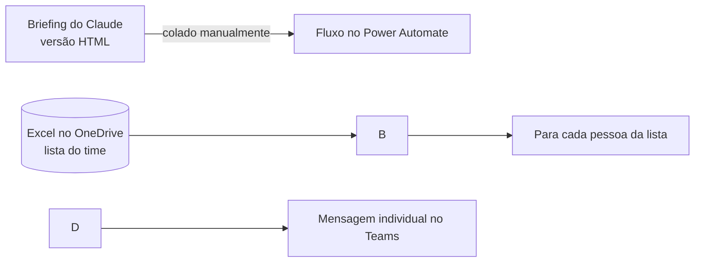

# Fluxo no Power Automate: envio do briefing pelo Teams

O aviso da tarefa agendada no Claude chega só para mim. Este fluxo leva o briefing para cada pessoa do time no Teams, sem precisar copiar e colar em cada conversa.

## Visão geral

## Etapas

1. **Entrada do briefing:** eu copio a versão em HTML que o Claude gera no final do aviso e colo no fluxo.
2. **Lista do time:** o fluxo lê uma tabela em uma planilha Excel salva no OneDrive com as pessoas que recebem o briefing.
3. **Envio individual:** para cada linha da tabela, o fluxo manda a mensagem no chat do Teams daquela pessoa.

## Por que a versão em HTML

O Teams não mostra markdown do mesmo jeito que o Claude. Por isso a tarefa agendada gera uma segunda versão da mensagem usando só as tags que o Teams aceita:

|Usa|Não usa|
|-|-|
|`<b>` `<i>` ` ` `<ul>` `<ol>` `<li>` `<a href>`|`<html>` `<head>` `<body>` `
` `
` `` `<h1>`–`<h6>`, tabelas e CSS|

Outras regras:

* As seções ficam em `<b>` seguidas de ` `.
* As tabelas (Indicadores e Agenda) viram listas `<ul>`.
* Os links mostram o endereço completo como texto, para não se perderem na cópia.
* Os caracteres `\&`, `<` e `>` são escapados.

## Manter a lista atualizada

Para incluir ou tirar alguém do envio, basta editar a planilha no OneDrive. O fluxo não precisa ser alterado.

## Próximo passo

Hoje a entrada do briefing é manual. O objetivo é o Power Automate buscar o resumo direto do Claude e eliminar essa etapa.

